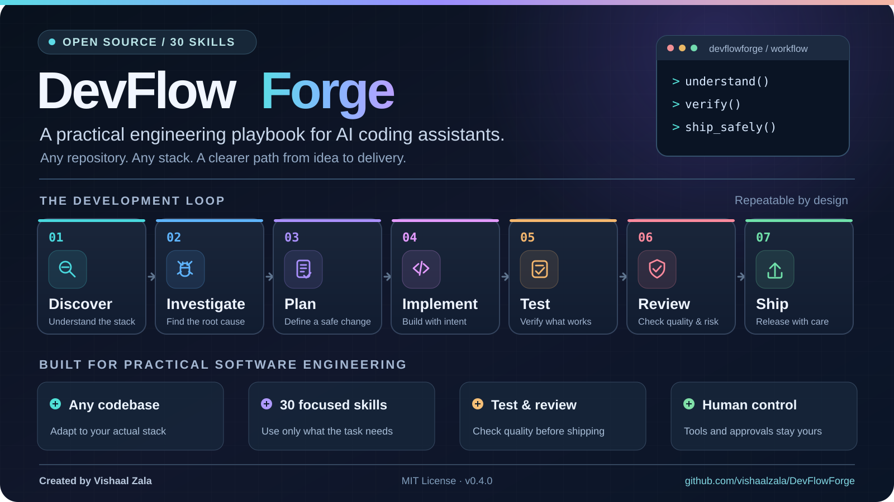

# DevFlowForge

<div align="center">



*From understanding an unfamiliar codebase to shipping a reviewed change — a repeatable workflow powered by 30 focused engineering skills.*

</div>

**Build thoughtfully. Test confidently. Ship safely.**

**DevFlowForge** is an open-source collection of **30 reusable engineering skills** for AI coding assistants. It helps developers apply repeatable workflows—**Discover → Investigate → Plan → Implement → Test → Review → Ship**—to any software project.

**Created by Vishaal Zala** · MIT License · Version 0.4.0

DevFlowForge is designed to be **project-agnostic**. Use it for web apps, APIs, mobile applications, SaaS products, command-line tools, open-source libraries, AI systems, data projects, and infrastructure. The assistant should inspect the actual repository and select only relevant skills; no particular language, hosting provider, or platform is required.

> **Important:** DevFlowForge provides instructions and review checklists, not a hosted AI model, independent coding agents, background workers, or automatic access to repositories. File edits, tests, deployments and pull requests require compatible tools, connected accounts and permission. Skill inclusion never guarantees a correct or secure result.

## Quick start

### Option A — Codex CLI (repository marketplace)

After the **public repository has been published** on GitHub, run on a compatible Codex CLI version:

```bash
codex plugin marketplace add vishaalzala/devflowforge
codex plugin marketplace list
codex plugin add devflowforge@devflowforge
codex plugin list --json
```

The repository contains `.agents/plugins/marketplace.json` and a portable root `plugin.json`. Codex capabilities and installation commands vary by product version; check the installed Codex CLI help if a command is unavailable. Add only one installation of this plugin per coding environment.

### Option B — ChatGPT (web or desktop)

1. Obtain the public GitHub source or the ZIP release of this repository.
2. In ChatGPT, use **Plugins** or a supported personal-plugin creation flow to create/install a skills-only plugin from the downloaded source, when available for your account.
3. Open a conversation and select **DevFlowForge**, or explicitly ask it to use a skill.
4. Connect GitHub or other development tools separately if you want the assistant to access your code or carry out changes.

A public GitHub repository **does not automatically install a ChatGPT plugin** or place it in the public ChatGPT Plugin Directory. Availability of these plugin workflows depends on account and client. If plugin creation isn't available, you can still use an individual `skills/<skill-name>/SKILL.md` as task guidance by attaching or pasting it into a conversation.

### Option C — Use skills directly with a coding assistant

Clone the repository and open your actual project with an AI coding assistant that can read local skill files:

```bash
git clone https://github.com/vishaalzala/devflowforge.git
cd devflowforge
python scripts/validate_plugin.py
```

Browse `skills/` and supply an applicable skill file as context, or use your coding assistant's documented project-skills mechanism. This is a fallback, not a guaranteed automatic skill discovery mechanism.

## Example prompts

**Debug an application**

> Use DevFlowForge's root-cause debugging workflow. Inspect this repository, reproduce the bug where possible, trace the failing code path, explain the root cause, propose the smallest safe fix, and provide a regression test. Distinguish verified facts from hypotheses.

**Build a feature**

> Use DevFlowForge to review the existing code and define acceptance criteria. Plan a compatible change, implement it in a branch if authorised, run available tests, perform a security review, and prepare a PR summary. Do not deploy without permission.

**Audit any codebase**

> Use DevFlowForge to map the architecture and stack, then evaluate maintainability, performance, accessibility, security and test coverage. Rank findings by evidence, severity and effort.

**Deploy safely**

> Use DevFlowForge's release safety process. Inspect CI/CD, define staging tests, smoke checks, feature flags and rollback options. Explain remaining risks and obtain approval before deployment.

**AI-assisted development**

> Use DevFlowForge's AI evaluation workflow. Define a dataset, quality metrics, confidence reporting and a human-review process before proposing changes to model prompts or routing.

## Included skills (30)

| Area | Skills |
| --- | --- |
| Core planning and repository analysis | `cto-orchestration`, `requirements-acceptance-criteria`, `cross-stack-codebase-onboarding`, `repository-architecture-audit`, `architecture-decisions-tradeoffs` |
| Coding and quality | `root-cause-debugging`, `safe-implementation-review`, `unit-integration-e2e-testing`, `maintainability-refactoring`, `project-knowledge-handoff` |
| Security and reliability | `security-permissions-billing`, `dependency-vulnerability-upgrades`, `monitoring-incident-response`, `ci-cd-release-safety`, `github-pr-lifecycle` |
| Application development | `frontend-ux-accessibility`, `performance-engineering`, `customer-portal-identity`, `invoice-job-kit-calculations`, `pdf-documents-export`, `offline-first-sync` |
| APIs, data and jobs | `api-webhook-integrations`, `database-migrations-import`, `background-jobs-idempotency`, `email-delivery-reliability`, `supabase-rls-multi-tenant`, `stripe-billing-integrity` |
| AI, search and discoverability | `ai-evaluation-human-review`, `crawler-search-systems`, `seo-content-automation` |

The specialist Supabase and Stripe skills are optional and should be used only when those services are part of the project.

## Repository layout

```text
devflowforge/
  plugin.json                         # Portable plugin manifest
  .codex-plugin/plugin.json          # Codex compatibility
  .agents/plugins/marketplace.json   # Repository marketplace metadata
  skills/<skill-name>/SKILL.md       # 30 reusable engineering skills
  references/                        # Project discovery and quality gates
  scripts/validate_plugin.py         # Structural and basic secrets check
  .github/workflows/validate.yml     # CI validation on PRs and pushes
  LICENSE, CHANGELOG.md, CONTRIBUTING.md, SECURITY.md
```

## Validate and contribute

Run Python 3.10+:

```bash
python scripts/validate_plugin.py
```

The validation script checks manifest consistency, skill layout, count and basic secret patterns. **It does not test integration with every model or coding assistant, verify runtime quality, or constitute a security audit.** Read [CONTRIBUTING.md](CONTRIBUTING.md) before submitting a PR; report security concerns via [SECURITY.md](SECURITY.md).

## Privacy and safety

Never commit credentials, tokens, customer data, private architecture or real production logs. Avoid destructive database operations and production deployments without explicit permission. Do not claim changes, tests or PRs succeeded unless supported by tool results. Keep a rollback path for risky modifications.

## License and author

MIT License — see [LICENSE](LICENSE).

**Created and maintained by Vishaal Zala.** Copyright © 2026 Vishaal Zala.
