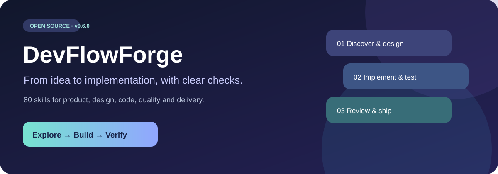
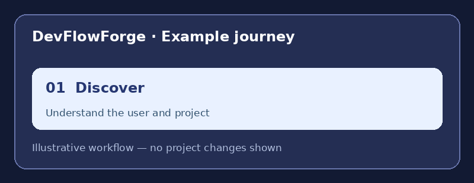
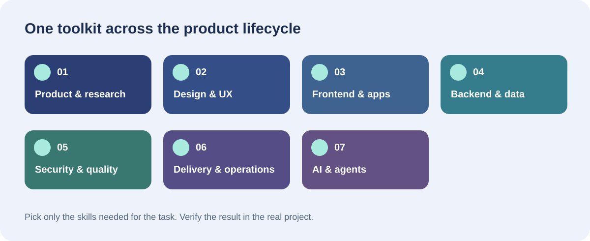
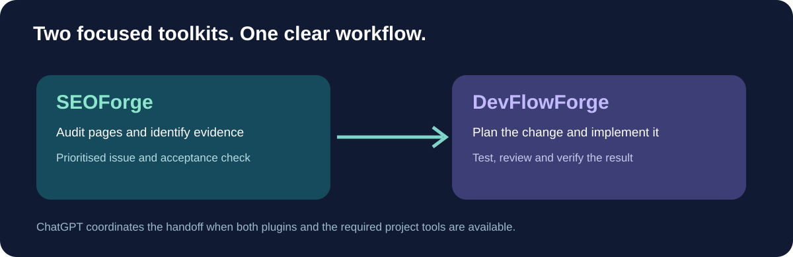

<div align="center">



# DevFlowForge

**Build thoughtfully. Test confidently. Ship safely.**

[What it covers](#what-can-it-help-with) · [See the workflow](#see-the-workflow) · [Installation](#installation) · [Skill catalog](#skill-catalog) · [SEOForge](#work-with-seoforge)

</div>

**DevFlowForge** is an open-source collection of **80 independently written, reusable engineering and design skills** for compatible AI coding assistants, created and maintained by **Vishaal Zala**. It works across projects, programming languages and platforms: product discovery, UX/UI design, architecture, implementation, testing, security, performance and delivery.

**Version 0.5.0 · 80 skills · MIT License**

> DevFlowForge is a package of instruction files, not a model, coding agent, Figma integration, browser, deployment service or permission grant. The AI assistant must have the relevant tools and authorisation to implement changes. Skills guide work; they do not guarantee correctness or compliance.

## See the workflow



*This animation illustrates how the skills guide a task; it is not a recording of a live project.*


A skill provides a repeatable approach. The assistant reads the real project, uses relevant skills, makes changes when authorised and reports the checks it actually ran.

## What can it help with?



| Area | Examples |
|---|---|
| **Product & research** | User interviews, journeys, product specs, UX copy, prioritization, experiments |
| **Design & UI/UX** | Brand identity, design systems, wireframes, Figma handoffs, visual critique, mobile UX, dashboards, landing pages, design-to-code |
| **Frontend & apps** | React/Vue/other web architectures, forms, async state, accessibility, native mobile apps, CLI UX, browser tests |
| **Backend & data** | APIs, authentication, databases, ETL, realtime events, caches, privacy, distributed services |
| **Quality & security** | Unit/integration/E2E tests, WCAG-oriented audits, contract testing, dependency reviews, security safeguards |
| **Delivery & operations** | Git workflows, CI/CD, feature flags, IaC, containers, costs, performance tracing, recovery and SLOs |
| **AI & agents** | AI evaluation, retrieval systems, agent-tool safeguards, prompt quality and skill testing |

## How to use DevFlowForge

1. Open the **actual project** in a compatible assistant or connect the repository using an authorised tool.
2. Ask for a concrete task and (optionally) name one skill by its directory name, such as `ui-ux-design`.
3. The assistant should discover the project stack, select **only relevant skills**, and explain any missing tool access.
4. Review the proposed design/plan, verify tests and approve sensitive or production operations explicitly.

**Example requests**

- **Design:** “Use `ui-ux-design`, `design-systems-tokens` and `wireframing-prototyping` to propose a responsive dashboard. Include empty/error states and accessibility.”
- **Design to code:** “Use `figma-design-handoff` and `design-to-code-implementation` to map an approved design to the existing components, then run browser visual regression checks.”
- **Bug fix:** “Use `root-cause-debugging` to reproduce the failure; propose the smallest patch, add a regression test, and open a reviewable PR.”
- **Performance:** “Use `web-vitals-performance-audit` to measure LCP, INP and CLS, compare a baseline, and recommend fixes supported by the measurements.”
- **Backend:** “Use `api-contract-versioning` and `authentication-session-security` to review this integration. Identify breaking changes and negative-access tests.”
- **AI project:** “Use `prompt-rag-retrieval-evaluation` to define groundedness tests and error slices for a retrieval feature.”
- **Deployment:** “Use `feature-flags-progressive-rollout` and `ci-cd-release-safety` to prepare a staged rollout, monitoring and rollback plan.”

## Testing-first development workflow

DevFlowForge includes `test-driven-development`, `unit-integration-e2e-testing`, `test-strategy-release-gates` and `authorized-penetration-test-handoff`.

For application behavior changes, use **Red → Green → Refactor**: write a meaningful failing test, implement the smallest fix, then refactor and rerun the affected tests. Unit tests cover individual rules; integration and contract tests cover connections; E2E tests protect important user journeys. Run accessibility, performance and acceptance checks where appropriate.

**Completion gate:** Report each applicable test as **Pass**, **Fail**, **Not run** or **Not applicable**, with actual commands and results. An unrun test is never a pass. Do not claim release readiness while required gates are failing.

**Optional security handoff:** When the project has exposed services or sensitive data, after functional verification ask: **“Would you like to arrange a scoped, authorized penetration test before release?”** Do not begin active scanning without the project owner's explicit authorization and an agreed scope. Performance testing is a separate, existing skill (`load-stress-capacity-testing`) that also requires authorization and safe load limits.

**Example:** “Use DevFlowForge TDD to implement this feature. Show the failing test, apply the smallest fix, run unit, integration and critical end-to-end tests, and give me a release-readiness report. Then ask whether a scoped security assessment makes sense.”

## Installation

### Codex CLI / native plugin marketplace

On a version of Codex that supports repository plugin marketplaces:

```bash
codex plugin marketplace add vishaalzala/DevFlowForge
codex plugin add devflowforge@devflowforge
codex plugin list --json
```

Verify the commands in `codex plugin --help` for your installed version. The repository includes `plugin.json`, `.codex-plugin/plugin.json` and `.agents/plugins/marketplace.json`. No automated execution or GitHub access is provided by installing skills alone.

### ChatGPT

Use a compatible ChatGPT personal plugin installation flow and import the repo package or install the author's DevFlowForge plugin when available to your account. Choose DevFlowForge in a conversation and connect code, design or cloud tools separately. **A GitHub repo is not automatically a public ChatGPT Directory listing.** If installation is unavailable, upload relevant `SKILL.md` files as context for a task.

### Other skills-aware coding assistants

```bash
git clone https://github.com/vishaalzala/DevFlowForge.git
cd DevFlowForge
python scripts/validate_plugin.py
```

Use your assistant's documented skills-loader, or supply a specific `skills/<name>/SKILL.md` as instruction context. Auto-discovery varies by host; do not assume every assistant supports these files automatically.

## Skill catalog

The root `skills/` directory contains **80 standalone SKILL.md files**. See [SKILL CATALOG](SKILLS.md) for a browsable, grouped table of all skills and direct links. See [Skill routing guide](references/skill-routing.md) for how to combine capabilities without loading everything at once.

## Work with SEOForge



[**SEOForge**](https://github.com/vishaalzala/SEOForge) is a companion project with **32 SEO skills** for website audits, search data interpretation, content, technical SEO and source-code fixes. DevFlowForge adds broader design, engineering, testing, security and delivery guidance when a finding calls for a website change. They are separate plugins; ChatGPT can coordinate skills from both when installed and available, with the project tools needed for the task.

**Example request:** “Use SEOForge to identify confirmed technical SEO issues in this site. Use DevFlowForge to implement the highest-priority fix in the connected repository, run relevant checks and show me the result.”

## Quality and contribution

Run the structural checks:

```bash
python scripts/validate_plugin.py
```

The checks validate packaging, names, skill count, basic completeness and limited secret patterns; they are **not** a functional, security or cross-assistant compatibility certification. For contributions, use [CONTRIBUTING.md](CONTRIBUTING.md). Document evidence when claiming a skill improves results, and add activation and nonactivation test prompts.

## Source research

DevFlowForge uses independently authored skills. The expansion was informed by a survey of public repository capabilities, recorded in [Research and coverage](references/research-and-coverage.md). These projects are linked for acknowledgment, not bundled or copied.

## Project independence and privacy

DevFlowForge doesn't contain your source code, private integrations or customer data. Always verify project facts from authorised sources. Never print secrets or publish private environment files. Request approval for destructive operations, financial actions and production deployments. Distinguish observed, tested and proposed results.

## Author and license

**Vishaal Zala** · [MIT License](LICENSE) · Copyright © 2026 Vishaal Zala.
