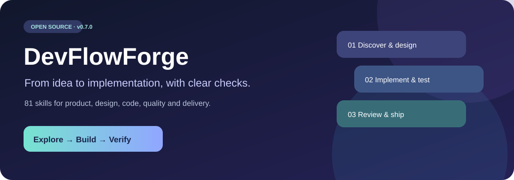
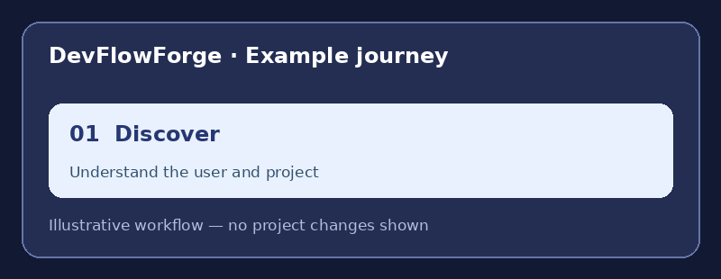
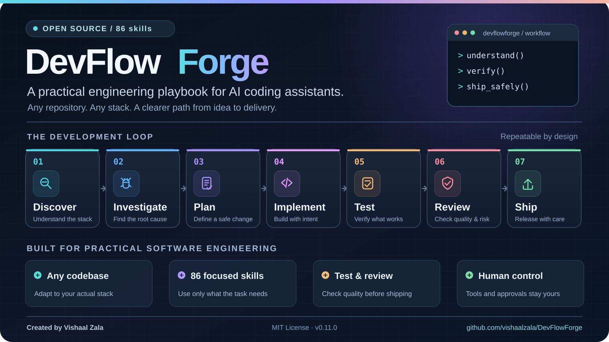
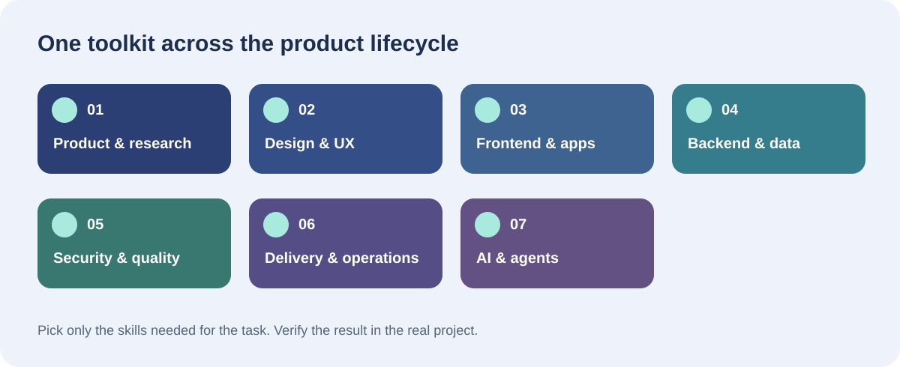
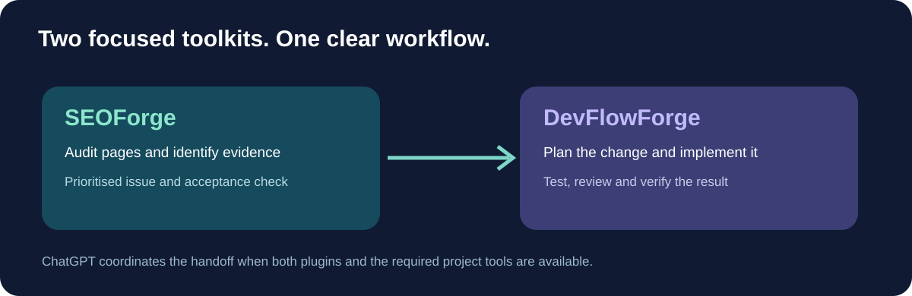

<div align="center">



# DevFlowForge

**Build thoughtfully. Test confidently. Ship safely.**

[What it covers](#what-can-it-help-with) · [See the workflow](#see-the-workflow) · [Installation](#installation) · [Skill catalog](#skill-catalog) · [SEOForge](#work-with-seoforge)

</div>

**DevFlowForge** is an open-source collection of **86 independently written, reusable engineering and design skills** for compatible AI coding assistants, created and maintained by **Vishaal Zala**. It works across projects, programming languages and platforms: product discovery, UX/UI design, architecture, implementation, testing, security, performance and delivery.

**Version 0.11.0 · 86 skills · MIT License**

> DevFlowForge is a package of instruction files, not a model, coding agent, Figma integration, browser, deployment service or permission grant. The AI assistant must have the relevant tools and authorisation to implement changes. Skills guide work; they do not guarantee correctness or compliance.

## See the workflow



*This animation illustrates how the skills guide a task; it is not a recording of a live project.*



A skill provides a repeatable approach. The assistant reads the real project, uses relevant skills, makes changes when authorised and reports the checks it actually ran.

## What can it help with?



| Area | Examples |
|---|---|
| **Product & research** | User interviews, journeys, product specs, UX copy, prioritization, experiments |
| **Design & UI/UX** | Distinct visual directions, brand identity, design systems, Figma handoffs, design quality and preservation checks, mobile UX, dashboards, design-to-code |
| **Frontend & apps** | React/Vue/other web architectures, forms, async state, accessibility, native mobile apps, CLI UX, browser tests |
| **Backend & data** | APIs, authentication, databases, ETL, realtime events, caches, privacy, distributed services |
| **Quality & security** | Site-wide browser QA auditor, unit/integration/E2E tests, WCAG checks, contract testing, dependency reviews, security safeguards |
| **Delivery & operations** | Git workflows, CI/CD, feature flags, IaC, containers, costs, performance tracing, recovery and SLOs |
| **AI & agents** | AI evaluation, retrieval systems, agent-tool safeguards, prompt quality and skill testing |

## How to use DevFlowForge

1. Open the **actual project** in a compatible assistant or connect the repository using an authorised tool.
2. Ask for a concrete task and (optionally) name one skill by its directory name, such as `ui-ux-design`.
3. The assistant should discover the project stack, select **only relevant skills**, and explain any missing tool access.
4. Review the proposed design/plan, verify tests and approve sensitive or production operations explicitly.

**Example requests**

- **Design:** “Use `ui-ux-design`, `design-systems-tokens` and `wireframing-prototyping` to propose a responsive dashboard. Include empty/error states and accessibility.”
- **Design to code:** “Use `figma-design-handoff` and `design-to-code-implementation` to map an approved design to the existing components, then run browser visual regression checks.”
- **Bug fix:** “Use `root-cause-debugging` to reproduce the failure; propose the smallest patch, add a regression test, and open a reviewable PR.”
- **Performance:** “Use `web-vitals-performance-audit` to measure LCP, INP and CLS, compare a baseline, and recommend fixes supported by the measurements.”
- **Backend:** “Use `api-contract-versioning` and `authentication-session-security` to review this integration. Identify breaking changes and negative-access tests.”
- **AI project:** “Use `prompt-rag-retrieval-evaluation` to define groundedness tests and error slices for a retrieval feature.”
- **Deployment:** “Use `feature-flags-progressive-rollout` and `ci-cd-release-safety` to prepare a staged rollout, monitoring and rollback plan.”

## Testing-first development workflow

DevFlowForge includes `test-driven-development`, `unit-integration-e2e-testing`, `test-strategy-release-gates` and `authorized-penetration-test-handoff`.

For application behavior changes, use **Red → Green → Refactor**: write a meaningful failing test, implement the smallest fix, then refactor and rerun the affected tests. Unit tests cover individual rules; integration and contract tests cover connections; E2E tests protect important user journeys. Run accessibility, performance and acceptance checks where appropriate.

**Completion gate:** Report each applicable test as **Pass**, **Fail**, **Not run** or **Not applicable**, with actual commands and results. An unrun test is never a pass. Do not claim release readiness while required gates are failing.

**Optional security handoff:** When the project has exposed services or sensitive data, after functional verification ask: **“Would you like to arrange a scoped, authorized penetration test before release?”** Do not begin active scanning without the project owner's explicit authorization and an agreed scope. Performance testing is a separate, existing skill (`load-stress-capacity-testing`) that also requires authorization and safe load limits.

**Example:** “Use DevFlowForge TDD to implement this feature. Show the failing test, apply the smallest fix, run unit, integration and critical end-to-end tests, and give me a release-readiness report. Then ask whether a scoped security assessment makes sense.”

## Adaptive HTTP compression (new in v0.7.0)

DevFlowForge includes [`adaptive-http-compression`](skills/adaptive-http-compression/SKILL.md), a standalone, platform-independent skill for reducing HTTP response transfer sizes without breaking browsers, mobile clients or caches. It is complemented by the detailed [compatibility and test matrix](references/http-compression-compatibility.md).

- Check the **actual** `Accept-Encoding` request header; do not assume Chrome on mobile lacks Zstd or try to identify mobile browsers by user-agent.
- Select **Zstd, Brotli or Gzip** only when both the client and the server/CDN support the option and measurements justify it.
- Do not offer **Normal** as a user-facing algorithm. Keep standards-compliant uncompressed (`identity`) fallback internally when needed.
- Preserve `Vary: Accept-Encoding` where applicable, private-data caching boundaries, streaming behavior and secure secret handling.
- Inspect the hosting/CDN first; if compression is already negotiated correctly, **don't add a duplicate compressor**.

**Example prompt:** “Use `adaptive-http-compression` to audit this website's HTML, JS, CSS and API responses. Check CDN and actual browser headers, test mobile/desktop compatibility and q-value edge cases, preserve secure caching and fallback, then implement only verified changes with tests and before/after byte/latency measurements. Do not deploy without approval.”

## Website QA Auditor (new in v0.8.0)

DevFlowForge includes a [site-wide audit skill](skills/website-qa-auditor/SKILL.md), an [audit and safety playbook](references/website-qa-audit-playbook.md) and a [local Playwright tool](tools/website-qa-auditor/README.md). Unlike a skills-only checklist, the optional runner can actually inspect an **authorised** running website once installed. It inventories same-origin pages, buttons, links, form fields, browser/API errors, responsive viewports and axe-core accessibility findings. JSON/Markdown reports contain the pages and actions observed; screenshots are opt-in.

Use the default **read-only crawl** for discovery. Real button/form and business-flow assertions require explicit scenario definitions, seeded test data and a separate approval for the exact **local/staging origin**. The runner never automatically clicks every control; payment/email/SMS/deletion and production operations must not be fired by generic exploration. No AI model or browser-hosting service is bundled; Playwright MCP and Stagehand are optional external integrations.

```bash
cd tools/website-qa-auditor
npm install
npx playwright install chromium
cp config/audit.example.json config/audit.json
# Edit config/audit.json for your approved local/staging website and allowed paths.
npm run audit -- --config config/audit.json
```

**Example prompt:** “Use `website-qa-auditor` to inventory all authorised routes, buttons, links, forms, roles and mobile layouts in my staging application. Build specific regression scenarios for the critical workflows, run only safe approved checks with Playwright, capture evidence and report failures without changing production.”

**Important:** The skill guides connected assistants; the separate Node tool needs to be installed and run in a machine or agent runtime with browser access. Installing the ChatGPT plugin alone does not start a browser audit or grant website access.

## Design Intelligence & Quality (new in v0.9.0)

DevFlowForge adds **three original skills**: [`visual-direction-engine`](skills/visual-direction-engine/SKILL.md) for distinct design concepts, [`design-quality-auditor`](skills/design-quality-auditor/SKILL.md) for evidence-based UI craft and responsive reviews, and [`design-preservation-verification`](skills/design-preservation-verification/SKILL.md) for keeping important content and controls intact during a redesign.

Unlike a rigid visual theme library, the module separates **objective problems** (overflow, missing buttons, broken accessibility or interactive states) from **subjective style suggestions** (repetitive cards or an overused composition). A brand can legitimately choose any colour, card shape or layout. The [design quality playbook](references/design-intelligence-quality.md) describes the review criteria.

For executable local checks, [`tools/design-intelligence/`](tools/design-intelligence/README.md) includes an **optional passive Playwright inspector** with mobile/desktop viewport audits, structural before/after reports and opt-in screenshots with pixel differences. It also includes a deterministic helper that presents three contrasting concept briefs from real supplied content. The tool is not an autonomous browser agent and does not run when you install the ChatGPT skill alone. It refuses production targets and never clicks or submits forms. For workflow tests use the separate Website QA Auditor.

**Example:** “Use `visual-direction-engine` to propose three brand-aware directions, implement the approved one, then use `design-quality-auditor` and `design-preservation-verification` to compare responsive layouts and verify controls/content before and after. Report any changes for review without deploying.”

## Research improvements (v0.10.0)

The Monday 9 November 2026 review strengthened **five existing skills areas**, without inflating the 85-skill count:

1. **Next.js security & tenant isolation**: version-aware, feature-conditional advisory checks with safe two-tenant fixtures (see [security review](references/nextjs-tenant-security-review.md)).
2. **Playwright QA reporting 2.0**: the existing Website QA and design inspectors now target Playwright 1.65 / Node.js 22+; a new [offline QA report aggregator](tools/qa-report-aggregator/README.md) combines issues, visual suggestions, visited route counts and observed workflow outcomes. Standalone `playwright` tools are distinct from `@playwright/test` reporters.
3. **Evidence-based skill evaluations**: the optional [offline skill evaluator](tools/skill-evaluator/README.md) compares user-provided baseline vs skill-assisted scoring evidence, tests activation and highlights safety regressions. It **does not call an LLM or independently grade model quality**.
4. **MCP interoperability & safety**: negotiated protocol revision, correct OAuth token audience, bounded scope elevation and untrusted tool outputs (see [compatibility matrix](references/mcp-version-compatibility.md)).
5. **Observability & background jobs**: SLO-based queue/run monitoring, retry evidence and privacy/cost controls (see [runbook](references/background-job-observability.md)).

These are portable engineering skills and optional local utilities, not a hosted agent, automatic scanner or production deployment. Run local checks with `python scripts/validate_plugin.py`, `npm --prefix tools/skill-evaluator test` and `npm --prefix tools/qa-report-aggregator test`. Any browser automation needs its own authorised local/staging environment.

## Architecture Connection & Impact Analysis (new in v0.11.0)

For every existing-project code task, DevFlowForge's CTO skill now explicitly classifies **Connected** versus **Isolated** work. Connected work requires an evidence-backed dependency map from the source and shared components through services, persistence, access policies and downstream consumers before fixes. The [skill](skills/architecture-connection-impact-analysis/SKILL.md) and [playbook](references/architecture-connection-impact-playbook.md) document impacted pages, responsibilities, regression tests and uninspected risks.

An [optional JSON impact checker](tools/architecture-impact-checker/README.md) rejects incomplete release attestations but does **not** crawl or analyze a repository by itself. Only authorized source access and actual tests can establish real-world correctness. No automatic modification of other connected modules or production data is permitted.

## Installation

### Codex CLI / native plugin marketplace

On a version of Codex that supports repository plugin marketplaces:

```bash
codex plugin marketplace add vishaalzala/DevFlowForge
codex plugin add devflowforge@devflowforge
codex plugin list --json
```

Verify the commands in `codex plugin --help` for your installed version. The repository includes `plugin.json`, `.codex-plugin/plugin.json` and `.agents/plugins/marketplace.json`. No automated execution or GitHub access is provided by installing skills alone.

### ChatGPT

Use a compatible ChatGPT personal plugin installation flow and import the repo package or install the author's DevFlowForge plugin when available to your account. Choose DevFlowForge in a conversation and connect code, design or cloud tools separately. **A GitHub repo is not automatically a public ChatGPT Directory listing.** If installation is unavailable, upload relevant `SKILL.md` files as context for a task.

### Other skills-aware coding assistants

```bash
git clone https://github.com/vishaalzala/DevFlowForge.git
cd DevFlowForge
python scripts/validate_plugin.py
```

Use your assistant's documented skills-loader, or supply a specific `skills/<name>/SKILL.md` as instruction context. Auto-discovery varies by host; do not assume every assistant supports these files automatically.

## Skill catalog

The root `skills/` directory contains **85 standalone SKILL.md files**. See [SKILL CATALOG](SKILLS.md) for a browsable, grouped table of all skills and direct links. See [Skill routing guide](references/skill-routing.md) for how to combine capabilities without loading everything at once.

## Work with SEOForge



[**SEOForge**](https://github.com/vishaalzala/SEOForge) is a companion project with **32 SEO skills** for website audits, search data interpretation, content, technical SEO and source-code fixes. DevFlowForge adds broader design, engineering, testing, security and delivery guidance when a finding calls for a website change. They are separate plugins; ChatGPT can coordinate skills from both when installed and available, with the project tools needed for the task.

**Example request:** “Use SEOForge to identify confirmed technical SEO issues in this site. Use DevFlowForge to implement the highest-priority fix in the connected repository, run relevant checks and show me the result.”

## Quality and contribution

Run the structural checks:

```bash
python scripts/validate_plugin.py
```

The checks validate packaging, names, skill count, basic completeness and limited secret patterns; they are **not** a functional, security or cross-assistant compatibility certification. For contributions, use [CONTRIBUTING.md](CONTRIBUTING.md). Document evidence when claiming a skill improves results, and add activation and nonactivation test prompts.

## Source research

DevFlowForge uses independently authored skills. The expansion was informed by a survey of public repository capabilities, recorded in [Research and coverage](references/research-and-coverage.md). These projects are linked for acknowledgment, not bundled or copied.

## Project independence and privacy

DevFlowForge doesn't contain your source code, private integrations or customer data. Always verify project facts from authorised sources. Never print secrets or publish private environment files. Request approval for destructive operations, financial actions and production deployments. Distinguish observed, tested and proposed results.

## Author and license

**Vishaal Zala** · [MIT License](LICENSE) · Copyright © 2026 Vishaal Zala.
